# UML exercise: reference diagrams (Mermaid, rendered by GitHub)

## Exo 1: Hospital Management System

### Class diagram (Tasks 1, 2, 3)
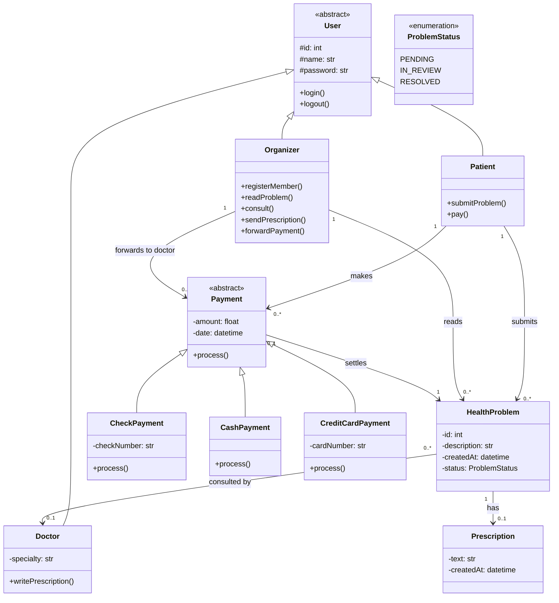

### Sequence diagram 1: submit a problem, receive a prescription, pay (Task 2)
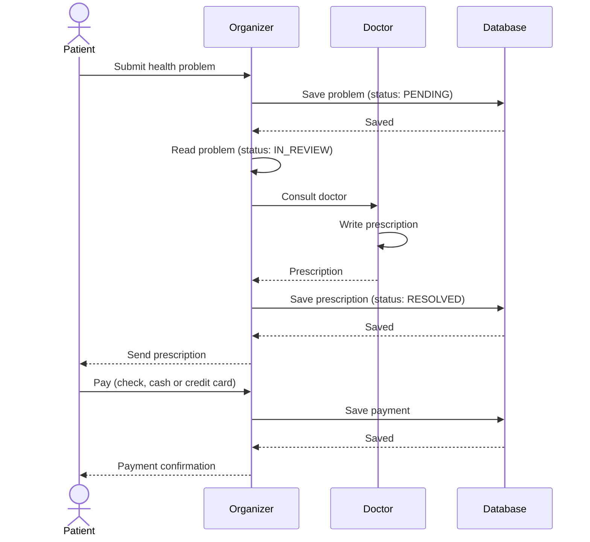

### Sequence diagram 2: patient registration (Task 3)
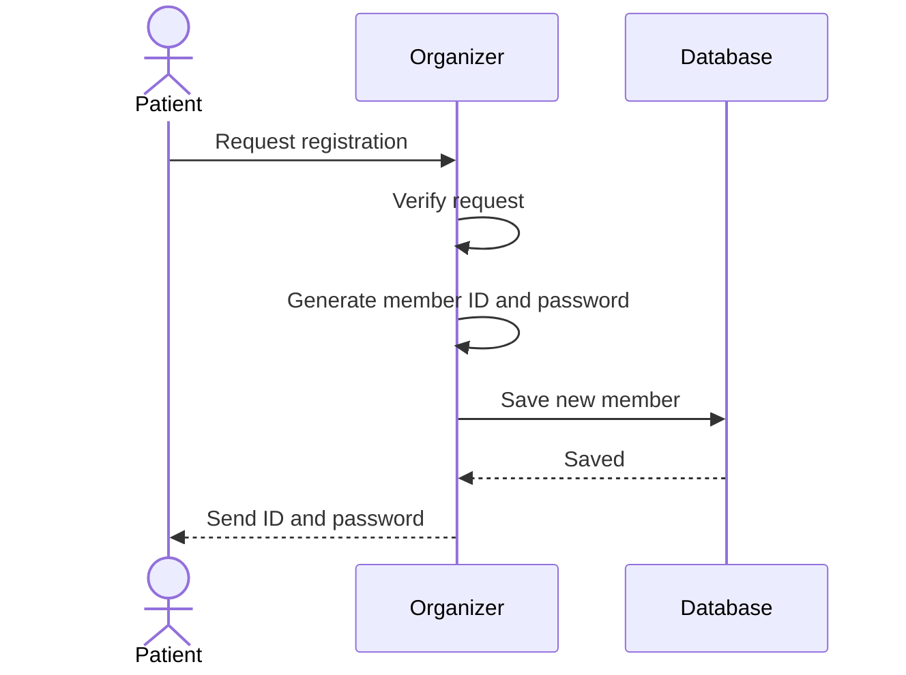

### Sequence diagram 3: consultation flow (Task 3)
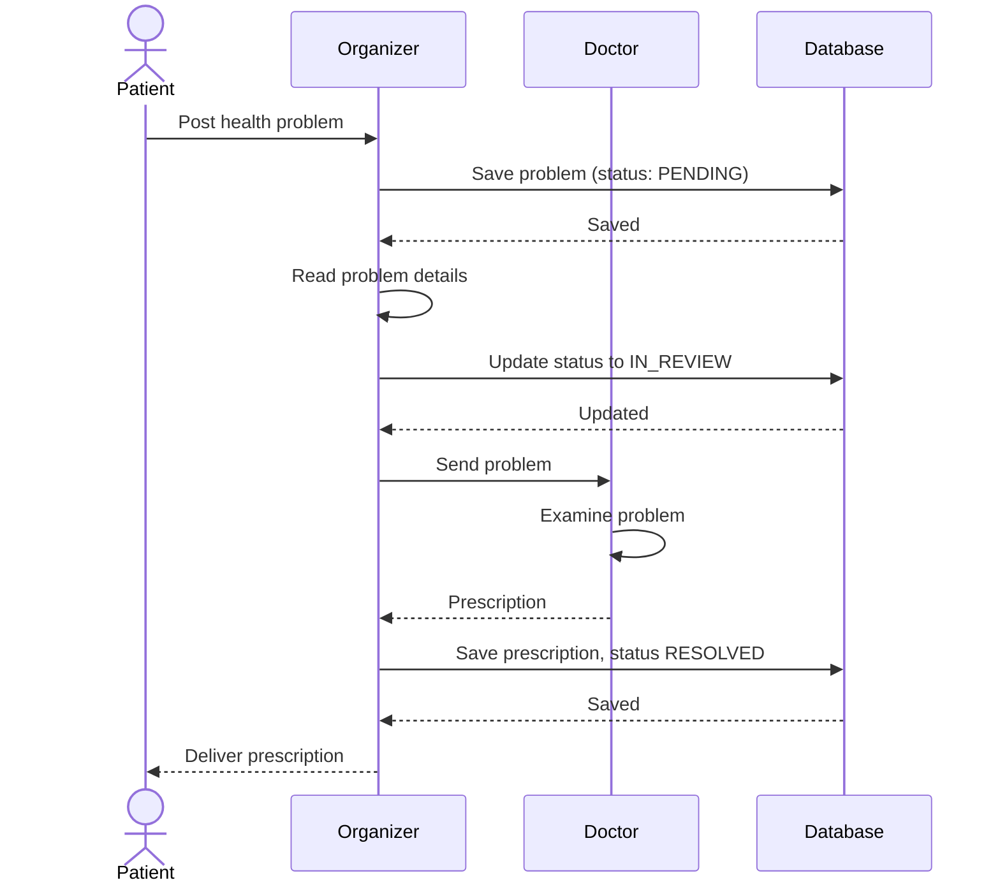

### Sequence diagram 4: payment processing (Task 3)
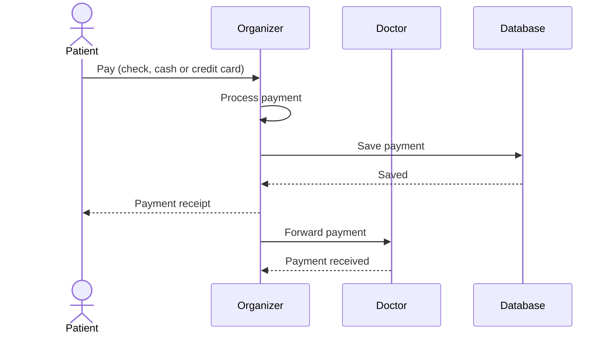

Questions to consider (short answers):
- **Several doctors per patient:** a patient has many problems, each problem is consulted by one doctor, so a patient can meet many doctors (Patient 1 to 0..* HealthProblem, HealthProblem 0..* to 0..1 Doctor).
- **Reusable prescriptions:** keep Prescription as its own class linked to the patient history, so a past prescription can be referenced by a new problem.
- **Design pattern for payments:** Strategy (Payment with Check, Cash and CreditCard subclasses sharing `process()`).
- **Data integrity:** save the payment and the status change in one database transaction (all or nothing), and only forward the payment to the doctor after it is saved.

---

## Exo 2: ABCD Records

### Use case diagram (Level 1 and 2)
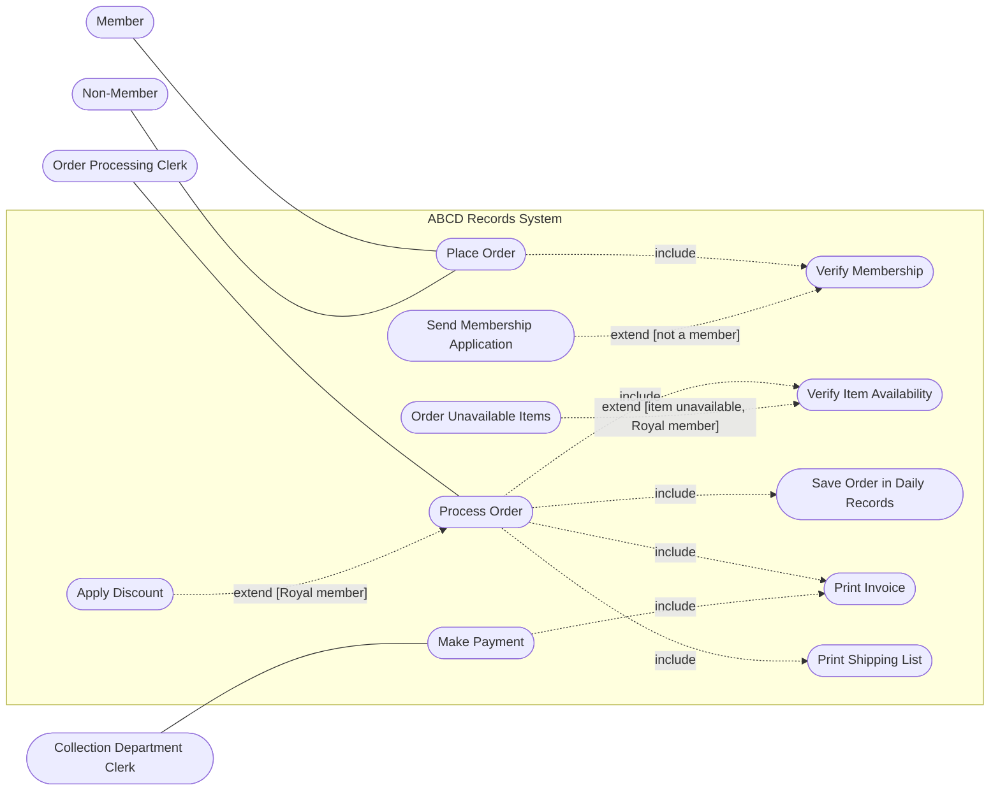

### Class diagram (Level 1 and 2)
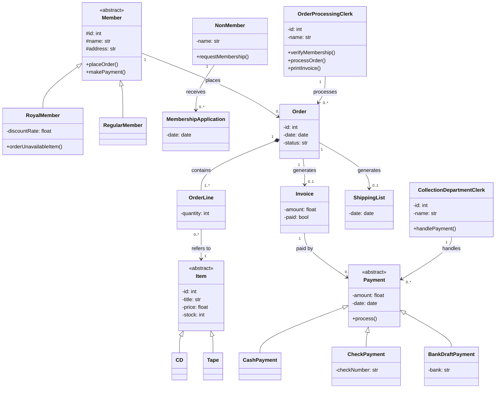
Scenario (Royal member orders 2 CDs, one unavailable, pays by check): a `RoyalMember` has one `Order` with two `OrderLine` objects pointing to two `CD` objects; the unavailable CD is re-ordered (royal privilege); one `Invoice` is generated (with the royal discount) and paid with one `CheckPayment`.

### Sequence diagram 1: complete order processing flow (Level 3)
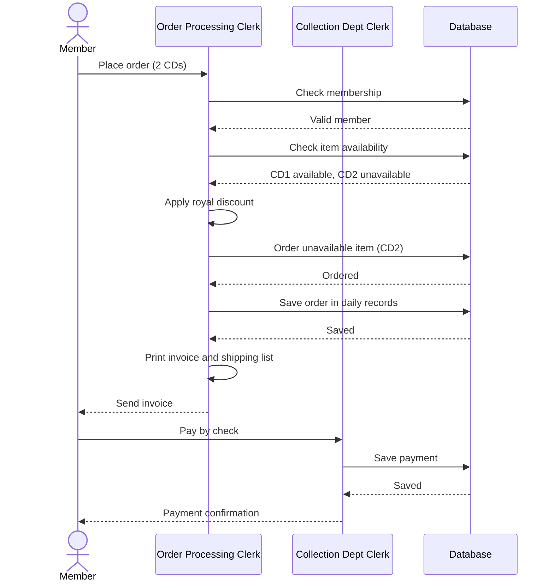

### Sequence diagram 2: membership verification (success and failure)
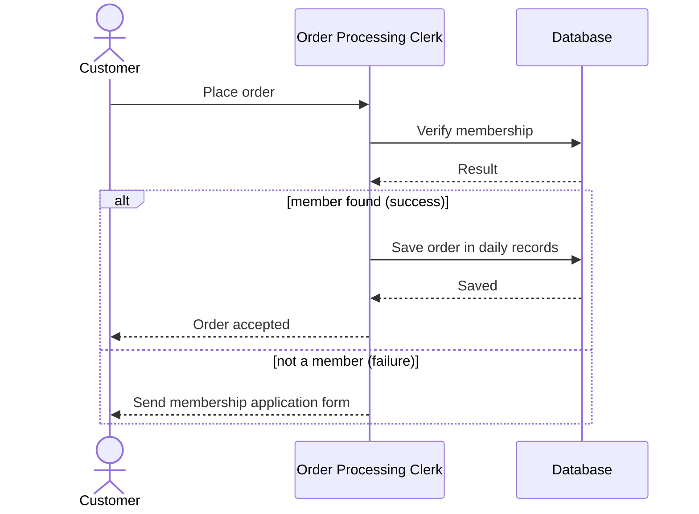

### Sequence diagram 3: payment processing (all types)
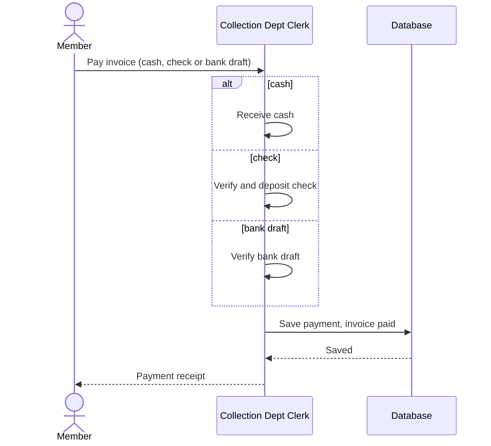

### Sequence diagram 4: item reordering for Royal members
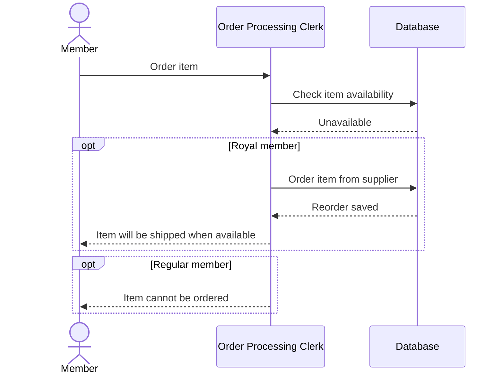
